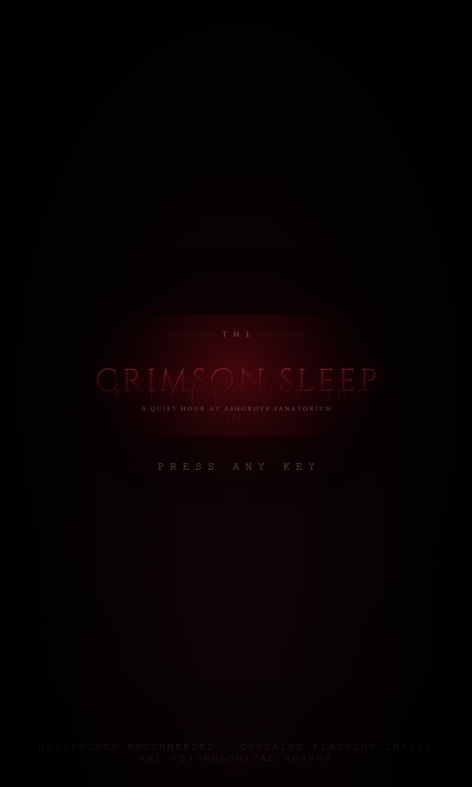

# THE CRIMSON SLEEP

A 2D survival-horror game. Ashgrove Sanatorium, the quiet hour, 1917. You are Dr. Mara Voss,
walking a building that has been dreaming for eleven nights, looking for the sister you put to
sleep. Ten rooms, three things hunting you, two endings, one candle at a time.

The whole simulation — movement and collision, enemy AI, sound propagation, puzzles, inventory,
journal, endings, save/load — is written in **C++17** and compiled to **WebAssembly**. The browser
layer only draws the frame, synthesises audio, and renders the interface. Nothing gameplay-relevant
is reimplemented in JavaScript.



## Play it

The game is a static site; it needs to be served over HTTP because it loads a `.wasm` module.

```bash
# macOS / Linux
python3 -m http.server 3000
# Windows (there is no `python3` command; use the py launcher)
py -m http.server 3000
# then open http://localhost:3000/
```

Run it from inside the unzipped game folder (the one containing `index.html`). If `py` or `python`
is "not found" or opens the Microsoft Store, Python is missing from `PATH` (re-run the installer and
tick *Add python.exe to PATH*) or the name is being answered by the Microsoft Store alias stub
(Settings → Apps → Advanced app settings → App execution aliases → turn off `python.exe` and
`python3.exe`). Any other static server works too, for example `npx serve .`.

Any static file server works (`npx serve`, `caddy file-server`, nginx, GitHub Pages). It has no
build step at runtime, no backend, no cookies and no network access beyond its own files. Progress is
kept in `localStorage` under the key `tcs_save_v1`.

## Deploying to Vercel

The repository is already configured for it. `vercel.json` pins the framework to *Other*, clears the
install and build commands, and serves the repository root, so nothing is compiled in the cloud.
Import the repository at [vercel.com/new](https://vercel.com/new) and accept the detected settings.

Three things keep that working:

- `assets/game.wasm` is committed. Vercel has no C++/Zig toolchain, so the compiled core has to be in
  the repo; `buildCommand` is `null` so no rebuild is attempted.
- The npm script used to be called `build`, which meant a project falling back to `package.json`
  scripts would try to run `./build.sh` on Vercel and fail. It is now `npm run build:wasm`.
- `.vercelignore` keeps the upload to the browser payload (`index.html`, `css/`, `js/`, `assets/`), so
  the C++ sources, docs and screenshots stay on GitHub without shipping. Every path the page loads is
  relative and lowercase, which matters because Vercel's filesystem is case-sensitive.

## Controls

| Key | Action | Key | Action |
| --- | --- | --- | --- |
| `W A S D` / arrows | move | `E` | interact / take / use |
| `Shift` | run (drains breath) | `F` | strike with the equipped weapon |
| `L` / `T` | torch on/off | `R` | reload the revolver |
| `Q` | use a bandage | `X` | swap weapon |
| `I` | satchel | `J` | journal (clues) |
| `M` | journal map | `Esc` | pause / back |

## What is in the game

- **Ten hand-authored rooms** joined by eighteen doors: Ward 3, the West Corridor, the Nurse Station,
  the Supply Closet, the Boiler Room, the Flooded Passage, the East Corridor, the Chapel, the Morgue
  and the Crimson Sleep. Locked doors update the navigation graph the moment they open.
- **Survival layer**: limited health, breath/stamina, revolver ammunition, bandages, torch battery,
  checkpoints at candles. Death returns you to the last candle you lit.
- **Three enemies** with the full state set (Idle, Patrolling, Suspicious, Investigating, Chasing,
  Attacking, Searching, Returning): the blind **Crawler** (hunts sound), the fast **Hound** (hunts
  sight) and the **Weaver**, an unkillable pursuer that walks the room graph after you.
- **Stealth**: line-of-sight cones, footstep noise, lockers to hide in, torch light that gives you
  away, and a danger meter that drives the music and heartbeat.
- **Puzzles**: the ward key, the boiler breaker (three fuses), the flooded passage valves, the
  four-digit mortuary lock, the chapel candle ritual, and the cradle at the end.
- **Story**: thirteen notes, a journal with clues, a map and a bestiary, scripted scares, a chase
  through the flooded passage, and two endings (walk away with the locket and the sedative, or lie
  down with the locket alone).
- **Presentation**: 480×270 pixel-art renderer upscaled with nearest-neighbour, dynamic flashlight
  and lighting, fog, grain, vignette, camera shake, and a fully procedural WebAudio soundtrack
  (six moods plus ambience, footsteps, weapons, heartbeat and stingers).

## Layout

```
index.html          boot screen, menu, HUD and every panel
css/style.css       all presentation
js/core.js          WebAssembly bridge (typed-array views over C++ memory)
js/render.js        canvas renderer, lighting composite, effects
js/audio.js         procedural synthesis (no audio files)
js/ui.js            screens, HUD, satchel, journal, keypad, settings
js/content.js       all prose: messages, subtitles, clues, endings, enemy lore
js/main.js          boot flow, input, frame loop, event → audio/FX, save/load
cpp/include/*.hpp   the data structures and game systems
cpp/src/*.cpp       their implementations, level data, interactions, save format
cpp/tests/tests.cpp 220 native assertions
assets/game.wasm    the compiled core
assets/logo.png     title card (generated, see "Assets")
build.sh            builds assets/game.wasm with Zig's clang + wasm-ld
tools/              art and test tooling (not shipped to the browser)
```

### How JavaScript talks to C++

C++ owns the state. `api.cpp` exports ~90 `extern "C"` functions and a set of flat blocks: the
player (32 floats), an enemy array (20 floats per slot), and struct-of-arrays blocks for props,
doors, items, lights, events and the explored map. `js/core.js` maps those addresses into
`Float32Array`/`Uint8Array` views and reads them each frame; input is a bitmask passed into
`tcs_update(dt, inputBits)`. There is no per-entity JSON marshalling and no gameplay logic in JS.

## Building the core

The build uses Zig 0.13.0 purely as a C++ cross-compiler (clang 18 + `wasm-ld`) targeting
`wasm32-freestanding`. No Emscripten, no STL, no libc — `cpp/src/libc_shim.cpp` provides the handful
of `mem*`/`str*`/`sqrtf` symbols the core needs.

```bash
mkdir -p "$HOME/toolchain"
curl -L -o /tmp/zig.tar.xz https://ziglang.org/download/0.13.0/zig-linux-x86_64-0.13.0.tar.xz
tar xf /tmp/zig.tar.xz -C "$HOME/toolchain"
ZIG="$HOME/toolchain/zig-linux-x86_64-0.13.0/zig" ./build.sh
# built assets/game.wasm (~352 KiB, 92 exports)
```

`build.sh` compiles `cpp/src/*.cpp`, collects every `extern "C"` name from `api.cpp` and passes it
as `-Wl,--export=<name>` (Zig's linker rejects `--export-all` for freestanding modules).

## Tests

```bash
# 220 assertions against the real C++ core, native build
g++ -std=c++17 -O1 -Icpp/include cpp/src/*.cpp cpp/tests/tests.cpp -o build/tests && ./build/tests

# boots the real site in jsdom with a real canvas, drives it, writes artifacts/*.png
node tools/web_test.mjs
```

Results are recorded in [docs/TEST_RESULTS.md](docs/TEST_RESULTS.md); the data-structure mapping is
in [docs/DATA_STRUCTURES.md](docs/DATA_STRUCTURES.md).

## Assets

There are no stock or third-party art, audio or font files in the shipped game. Every sprite, tile,
light, grain field and sound is generated at runtime by `js/render.js` and `js/audio.js`.

The title card is the one bitmap: `assets/logo.png` is rendered from vector drawing code by
`tools/logo.mjs` (Cinzel and EB Garamond are used only while generating that PNG, never loaded by the
page). Replace that file to re-brand the title screen — `index.html` references it directly.

## Known limitations

- Audio is synthesised, not recorded: it is stylised rather than realistic, and it starts on the first
  key press because browsers require a gesture before audio can play.
- The game targets a keyboard and a desktop-sized viewport; it has no touch controls.
- Save data is a binary blob in `localStorage`; clearing site data resets progress to the last candle
  (or to the title if none was lit).
